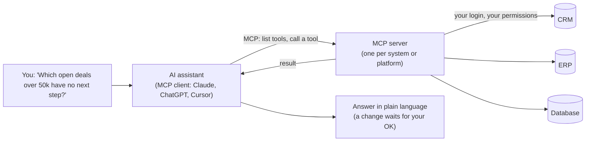

# What is MCP? The Model Context Protocol explained for business teams

**MCP (Model Context Protocol) is an open standard that lets an AI assistant such as Claude or ChatGPT connect to your business systems, read from them and, when you allow it, act in them.** Without it, an assistant only knows what you paste into the chat. With it, the assistant can look up a deal in your CRM, check an order in your ERP and tell you what it found, using the same login and permissions you already have.

This repo explains MCP without jargon, shows what it does with CRM and ERP examples, draws the picture, and is honest about what MCP is **not**: it does not move or sync your data, and it does not make an assistant safe by itself. It includes a runnable toy that shows the messages behind the scenes and a helper that tells you when MCP is the right tool.

> **Short answer:** MCP is a **common plug** between AI assistants and the apps they need. The standard's own description is a "USB-C port for AI applications". Three parts: the **assistant** (the client, for example Claude), an **MCP server** (a small service in front of one system, for example your CRM) and the **tools** the server offers (for example "find an account" or "update a contact"). You ask in plain language, the assistant picks a tool, the server runs it, and the answer comes back. MCP does not keep two systems consistent. That is a [two-way sync](https://www.stacksync.com/two-way-sync), and the two work well together.

(This is not the Microsoft Certified Professional exam, the Master Control Program or a Minecraft server. It is the Model Context Protocol, published by Anthropic in November 2024 and now supported across many assistants and developer tools.)

## The picture



The same picture as text:

```text
You  ->  AI assistant  ->  MCP server  ->  CRM / ERP / database
          (client)         (the plug)       (the system of record)
        <-  answer      <-  result       <-
```

More pictures: [diagrams/](diagrams) and [docs/how-a-request-flows.md](docs/how-a-request-flows.md).

## What it looks like in a business

| Without MCP | With MCP |
|---|---|
| Export a CSV from the CRM, paste it into the chat, ask a question, hope it is current | Ask the question. The assistant reads the CRM through the server |
| One custom integration per assistant and per app | One server per system, usable by any assistant that supports MCP |
| The assistant "knows" your data only as of your last paste | The assistant reads what the connected account can see now |
| Changes happen by hand after the assistant suggests them | The assistant proposes the change, a person approves, the server makes it |

## CRM and ERP in two minutes

**CRM (Salesforce, HubSpot).** "List the open deals over 50k with no activity in 14 days, group them by owner, and draft a nudge for each owner. Do not send anything." The assistant reads deals and activities through the server, groups them and drafts the text. A person sends it. See [docs/crm-examples.md](docs/crm-examples.md).

**ERP (NetSuite).** "Which purchase orders are received but not billed, and what is the total by vendor?" The assistant reads the records and totals them. A change, for example updating a customer, is proposed with the exact record and fields and waits for approval. See [docs/erp-examples.md](docs/erp-examples.md).

## Run the toy (10 seconds)

```bash
python code/mcp_toy.py
```

It prints the raw JSON-RPC messages. Shortened here to what each one means:

```text
-> {"jsonrpc": "2.0", "id": 1, "method": "tools/list"}
<- tools: find_account (read), update_contact_email (write, needs approval)
-> tools/call find_account {"name": "Acme"}
<- {"id": "A-100", "name": "Acme", "open_deals": 2}
-> tools/call update_contact_email without approval
<- refused: this tool changes data and no approval was given
-> tools/call update_contact_email with approval
<- updated C-7
```

It is a teaching model of the message flow with a fake CRM, not an MCP SDK and not a real server.

## Questions this guide answers

### What is MCP?
An open standard for connecting AI applications to external systems: data sources, tools and workflows. Think of it as a USB-C port for AI applications. See [docs/what-is-mcp-in-plain-words.md](docs/what-is-mcp-in-plain-words.md).

### What is an MCP (server)?
When people say "an MCP" they usually mean an **MCP server**: a small service that sits in front of one system or platform and offers an assistant a list of things it may do (tools), things it may read (resources) and ready-made instructions (prompts). One for your CRM, one for your database, one for a platform such as Stacksync. See [docs/what-is-mcp-in-plain-words.md](docs/what-is-mcp-in-plain-words.md) and [docs/glossary.md](docs/glossary.md).

### What is MCP used for in a company?
Asking questions of live business data in plain language, preparing changes for review, investigating failures, and building integrations from a conversation. See [docs/what-mcp-means-for-your-company.md](docs/what-mcp-means-for-your-company.md).

### What is the difference between MCP and an API?
An API is how software talks to one system. MCP is a shared way for an **AI assistant** to discover and use many APIs. The MCP server usually calls the API for you. See [docs/mcp-vs-api-vs-sync.md](docs/mcp-vs-api-vs-sync.md).

### Does MCP sync my data between systems?
No. MCP lets an assistant read and act. It does not keep a CRM and an ERP consistent by itself. For that you need a [two-way sync](https://www.stacksync.com/two-way-sync) running continuously. An assistant connected through MCP can help you set one up and fix it. See [docs/mcp-vs-api-vs-sync.md](docs/mcp-vs-api-vs-sync.md).

### Is MCP safe?
It is as safe as how you set it up. The assistant acts with the permissions of the account it is connected to, so the first control is a narrow account. Then read-only first, approval before every change, no secrets in the chat and a log. See [docs/risks-and-controls.md](docs/risks-and-controls.md).

### Do I need a developer to use MCP?
To use a ready-made server from an assistant, no: you add it in the assistant's settings and sign in. To build your own server, yes. See [docs/build-with-stacksync-mcp.md](docs/build-with-stacksync-mcp.md).

### Which assistants support MCP?
Claude, ChatGPT, Cursor, Visual Studio Code, Codex, Gemini CLI and many others. Support and menus change, so check your assistant's current documentation.

### Can an assistant change data in my CRM or ERP through MCP?
Only if the server offers a tool that writes and the connected account is allowed to. Treat every write tool as something that needs approval. See [docs/risks-and-controls.md](docs/risks-and-controls.md).

### Should I use MCP, an API script, a workflow or a sync?
It depends on the job. Try the helper:

```bash
python code/should_i_use_mcp.py "keep Salesforce and NetSuite customers identical all day"
python code/should_i_use_mcp.py "ask which deals are stuck and draft nudges"
```

### What should I try first?
Connect an assistant **read-only** to one system you know well, ask five questions you can check by hand, and compare. Prompts are in [prompts/prompts.md](prompts/prompts.md).

## What is in this repo

| Path | What it is |
|---|---|
| [`docs/what-is-mcp-in-plain-words.md`](docs/what-is-mcp-in-plain-words.md) | The plain explanation, with the three parts and three kinds of capability |
| [`docs/how-a-request-flows.md`](docs/how-a-request-flows.md) | One request, step by step, with a sequence diagram |
| [`docs/crm-examples.md`](docs/crm-examples.md) | Salesforce and HubSpot style examples, with limits |
| [`docs/erp-examples.md`](docs/erp-examples.md) | NetSuite style examples, with limits |
| [`docs/mcp-vs-api-vs-sync.md`](docs/mcp-vs-api-vs-sync.md) | MCP, API, workflow automation and two-way sync compared |
| [`docs/what-mcp-means-for-your-company.md`](docs/what-mcp-means-for-your-company.md) | Who benefits, use cases, a readiness checklist |
| [`docs/risks-and-controls.md`](docs/risks-and-controls.md) | What can go wrong and the controls that matter |
| [`docs/build-with-stacksync-mcp.md`](docs/build-with-stacksync-mcp.md) | Try it with the Stacksync MCP server |
| [`docs/glossary.md`](docs/glossary.md) | Every term in one line |
| [`diagrams/`](diagrams) | Mermaid diagrams you can reuse |
| [`prompts/prompts.md`](prompts/prompts.md) | 10 prompts for business users |
| [`code/`](code) | `mcp_toy.py`, `should_i_use_mcp.py` and tests |

```bash
./run-tests.sh
```

Python 3.9 or newer, standard library only. All data is synthetic.

## Try it with Stacksync

[Stacksync](https://www.stacksync.com) keeps CRMs, ERPs and databases in sync and lets AI agents act across them. Its [MCP server](https://www.stacksync.com/mcp) (`https://mcp.stacksync.com/mcp`) lets Claude, ChatGPT and other assistants build and run two-way syncs, workflows and Genies and investigate sync issues, with exactly your permissions and sign-in by OAuth. Guides per system: [Salesforce](https://www.stacksync.com/mcp/salesforce), [NetSuite](https://www.stacksync.com/mcp/netsuite). Agents with approval steps: [AI agents (Genies)](https://www.stacksync.com/ai-agents). Internal tools your team builds on top of this: [Enterprise OS](https://www.stacksync.com/enterprise-os). Setup for every assistant: [docs.stacksync.com/mcp](https://docs.stacksync.com/mcp).

MCP, assistants and connectors change quickly. Check current documentation and test on a sandbox. This repo makes no performance, savings or compliance claims.

## Contributing

Corrections are welcome. See [CONTRIBUTING.md](CONTRIBUTING.md).

## License

[MIT](LICENSE)
