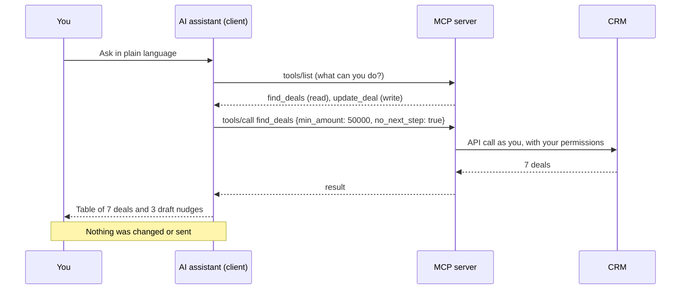
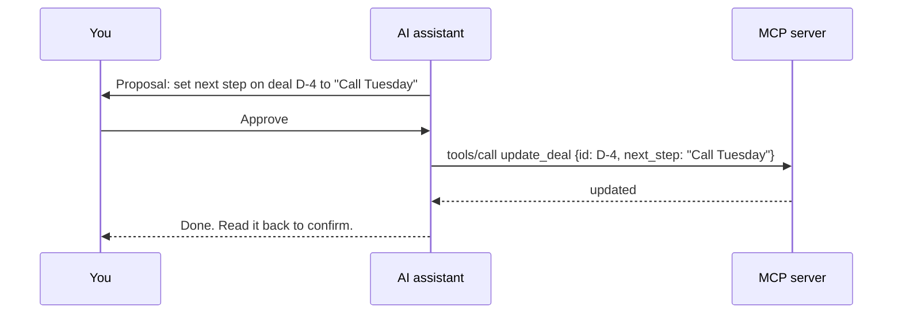

# How one request flows through MCP

The request: "Which open deals over 50k have no next step? Draft a nudge for each owner. Do not send anything."

## What each step protects

| Step | Control to look for |
|---|---|
| Sign-in | OAuth in the browser. No password or key in the chat |
| `tools/list` | You can see which tools exist. Turn write tools off |
| `tools/call` | Inputs are visible. A good client shows them before a write |
| The system call | The CRM enforces your role. The server cannot see more than you can |
| The answer | Ask the assistant to say what it could not see |

## A write, for comparison

Two habits: **propose, then approve, then read back.**

## The wire format, briefly

MCP messages are JSON-RPC 2.0. Two you will see: `tools/list` and `tools/call`. `python code/mcp_toy.py` prints both against a fake CRM.
